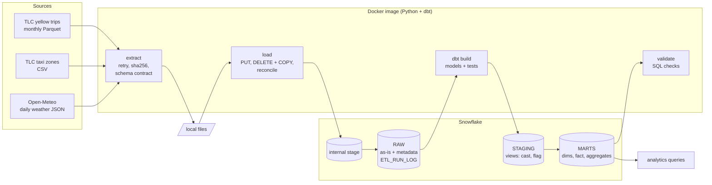

# NYC Taxi + Weather: batch ELT on Snowflake with dbt

A small, production-style batch pipeline. Python extracts three public datasets and loads them unmodified into a Snowflake `RAW` schema; dbt turns them into a tested dimensional model. Everything runs in one Docker image through `make`.

It is an **ELT** pipeline (often filed under "batch ETL"): Python only extracts and loads, and every transformation happens in the warehouse with dbt. That keeps the raw data replayable, puts business logic in version-controlled SQL with tests, and uses Snowflake's compute rather than a container's memory for 11 million rows.

**Stack:** Docker, Python 3.12, Snowflake, dbt Core 1.12 (dbt-snowflake), GitHub Actions.

## Architecture



`make pipeline` runs extract, load, transform, validate in that order and stops at the first failure with a non-zero exit code.

### Lineage

| Layer | Object | Grain | Built from |
|---|---|---|---|
| RAW | `YELLOW_TRIPS` | one trip | monthly Parquet files |
| RAW | `TAXI_ZONE_LOOKUP` | one zone | zone CSV |
| RAW | `WEATHER_DAILY_JSON` | one API response (a month) | Open-Meteo JSON |
| RAW | `ETL_RUN_LOG` | one file per run | the load step |
| STAGING | `stg_yellow_trips` | one trip | renamed, cast, decoded, flagged |
| STAGING | `stg_taxi_zones` | one zone | `N/A` strings to null |
| STAGING | `stg_weather_daily` | one day | JSON arrays flattened |
| MARTS | `dim_zones`, `dim_date` | zone, day | staging |
| MARTS | `fct_trips` | one trip (incremental) | `stg_yellow_trips` |
| MARTS | `agg_daily_trips_weather` | one day | fact + date dim + weather |
| MARTS | `agg_zone_performance` | pickup zone x month | fact + zone dim |

## Quickstart

Prerequisites: Docker Desktop, GNU Make, `openssl`, and a Snowflake account (a free trial works) where you can use `ACCOUNTADMIN` once.

```bash
# 1. Configuration
cp .env.example .env

# 2. Key pair for the pipeline's service user (stays in ./secrets, which is gitignored)
openssl genrsa 2048 | openssl pkcs8 -topk8 -inform PEM -out secrets/rsa_key.p8 -nocrypt
openssl rsa -in secrets/rsa_key.p8 -pubout -out secrets/rsa_key.pub
```

3. Paste `sql/00_snowflake_setup.sql` into a Snowsight worksheet. Replace `<PASTE_PUBLIC_KEY_BODY>` with the contents of `secrets/rsa_key.pub`, without the `BEGIN`/`END` lines and joined into **one line**. Then run it with **Run All** (Cmd/Ctrl+Shift+Enter). The plain Run button executes only the statement under the cursor, which fails with "Database 'NYC_TAXI' does not exist". The script is idempotent, so re-running it is safe. It creates the database, schemas, an X-Small warehouse, a resource monitor, and a least-privilege role and service user. Do not commit your edited copy.
4. In `.env`, set `SNOWFLAKE_ACCOUNT` to the value of `SELECT CURRENT_ORGANIZATION_NAME() || '-' || CURRENT_ACCOUNT_NAME();`, run in Snowsight. The other defaults match the setup script.

```bash
# 5. Build, check the connection, run everything
make build
make check-connection
make pipeline
```

Other targets (`make help` lists all):

| Target | What it does |
|---|---|
| `make extract` / `load` / `transform` / `validate` | Run one step |
| `make pipeline START=2025-01 END=2025-01` | Run for a different month range |
| `make load FORCE=1` | Reload files even if an identical copy is already in RAW |
| `make analytics` | Print the answers to the business questions |
| `make docs` / `make docs-serve` | Generate dbt docs / serve them on http://localhost:8080 |
| `make test` | Ruff lint, format check and unit tests |
| `make dbt ARGS="build --full-refresh"` | Any dbt command |

## Data sources

All three were checked against the live source before any code was written; URLs and column names are the verified ones.

| Source | What | Terms | Caveats |
|---|---|---|---|
| [NYC TLC Trip Record Data](https://www.nyc.gov/site/tlc/about/tlc-trip-record-data.page), yellow taxi | Monthly Parquet, about 3.5 to 4.1 million trips each. Field meanings from the [TLC data dictionary](https://www.nyc.gov/assets/tlc/downloads/pdf/data_dictionary_trip_records_yellow.pdf) (2025-03-18). | No licence text is published on the page. TLC states: "The trip data was not created by the TLC, and TLC makes no representations as to the accuracy of these data." | Published about two months in arrears. Vendor-submitted, so it contains meter errors (see "Data quality"). Tips are recorded for card payments only. Timestamps are New York local time with no zone. The schema changes between months. |
| NYC TLC Taxi Zone Lookup | CSV, 265 zones | Same page and disclaimer as above | Uses the literal string `N/A` for missing values. Zones 264 and 265 are placeholders for "Unknown" and "Outside of NYC". |
| [Open-Meteo Historical Weather API](https://open-meteo.com/en/docs/historical-weather-api) | Daily temperature, precipitation, rain, snowfall and wind for 40.7128, -74.0060 | [CC BY 4.0](https://open-meteo.com/en/licence). The free API is for non-commercial use, under 10,000 calls a day; this pipeline makes one call per month loaded. | Reanalysis model output for the nearest grid cell (the API returns 40.738, -74.043), not a weather-station observation. One point stands in for the whole city. |

**Attribution:** [Weather data by Open-Meteo.com](https://open-meteo.com/). Taxi data from the NYC Taxi & Limousine Commission.

## Design decisions and trade-offs

**RAW is loaded as-is, with four metadata columns.** `_SOURCE_FILE`, `_FILE_ROW_NUMBER`, `_BATCH_ID` and `_LOADED_AT` are added to every row; nothing is cleaned or filtered in Python. Trade-off: RAW columns are typed (not a single VARIANT), which is easier to query and cheaper to scan, at the cost of needing an explicit answer to schema drift.

**Idempotent loads: delete by file, then COPY, in one transaction.** For each file the load deletes rows previously loaded from that file, runs `COPY INTO ... FORCE = TRUE`, counts the rows now in RAW for that file, and commits only if the count equals the source file's row count. A mismatch rolls back, so a failed load never replaces a good one. A file whose sha256 matches its last successful load is skipped (logged as `SKIPPED`), which avoids rewriting millions of unchanged rows; `FORCE=1` reloads anyway, which is needed after changing how files are parsed. Weather files reload on every run because each Open-Meteo response embeds its own generation time, so its checksum always changes; that is three small rows. `ETL_RUN_LOG` records every file on every run as `SUCCESS`, `SKIPPED` or `FAILED`, with source and loaded row counts, size, sha256, any schema-drift notes and timings. Trade-off: `FORCE = TRUE` bypasses Snowflake's own load-history deduplication, so correctness rests on the delete being in the same transaction.

**Schema drift is handled by an explicit contract** in `src/sources.py`, checked against each Parquet file's footer before upload. The TLC files really do drift:

| Observed drift | Example | Handling |
|---|---|---|
| Column added | `cbd_congestion_fee` appears in 2025-01 | Optional column: absent means NULL, noted in the run log |
| Name case changed | `airport_fee` (2023) vs `Airport_fee` (2024+) | Matched case-insensitively to one canonical column |
| Numeric type changed | `passenger_count` DOUBLE (2023) vs INT64 (2025) | RAW stores the widest type; staging casts to the business type |
| Unknown new column | none yet | Preserved in `_EXTRA_COLUMNS` (VARIANT) with a warning, not dropped |
| Required column missing, or number became text | none yet | File is rejected before anything is loaded |

The `COPY` select list is generated from the file's actual column names, so the mapping is explicit. Trade-off: more code than `MATCH_BY_COLUMN_NAME`, in exchange for a failure before load rather than silently NULL columns.

**Surrogate key from file and row number.** TLC publishes no trip identifier and no combination of business columns is guaranteed unique, so `trip_key = hash(source file, row number in file)`. It is unique, deterministic, and stable when a month is reloaded. Trade-off: if TLC republishes a file with rows in a different order, keys change; the fact is replaced per file, so it stays consistent.

**`fct_trips` is incremental by file with `delete+insert`.** A run picks up files loaded since the last build and replaces each wholesale. A merge on `trip_key` would leave stale rows behind if a republished file had fewer rows.

**Invalid records are flagged, not dropped.** `stg_yellow_trips` evaluates each rule into a boolean and summarises them in `is_valid_trip`. The fact keeps every row; the aggregated marts use valid trips only. This keeps data-quality rates measurable and the choice reversible. Thresholds are dbt `vars`.

**Key-pair authentication, least-privilege role.** The brief allowed password auth, but Snowflake service users (`TYPE = SERVICE`) cannot use passwords, so the pipeline uses an RSA key pair. Its role can use one warehouse and create objects in three schemas of one database, nothing else; the CLI refuses to run as an admin role. Admin DDL lives in one script that a human runs once.

**One image, pinned.** Python and dbt share an image running as a non-root user. Top-level versions are pinned in `requirements*.txt` and the full resolved set in `requirements.lock`.

## Results (default run: January to March 2025)

| | |
|---|---|
| Trips loaded to RAW and the fact | 11,198,026 (3,475,226 + 3,577,543 + 4,145,257; equal to the Parquet footers) |
| Valid trips used by the aggregates | 10,631,360 (94.9%) |
| `dbt build` | PASS=58, WARN=3, ERROR=0 |
| Validation checks | 9 of 9 passed |
| `make pipeline` re-run | 49 seconds, no rows rewritten |

Answers from `make analytics` (queries in `sql/analytics/`; valid trips only):

1. **Demand by hour and borough.** Demand builds through the day to a peak at 18:00 (7.5% of all trips), and the quietest hour is 04:00 (0.7%). Manhattan accounts for 87 to 89% of pickups every month. Queens is second, at 8 to 9%, and its pickups are dominated by the airports: they average 11 miles and about $65 per trip, against 2.2 miles and $23 in Manhattan.
2. **Tipping by payment type.** Credit card trips (70% of the total) tip 26% of the fare on average, and 94% of them tip at all. Cash trips show $0.00 tips, but that reflects the data, not the passengers: TLC does not record cash tips. "Flex Fare" (code 0, 18% of trips) is a newer category whose records leave several fields empty; only 10% of those trips show a tip.
3. **Rain.** Rainy days (at least 1 mm) averaged 2% more trips than dry days on weekdays (118,745 vs 116,529) and 4% more at weekends. Weekday fares were $0.68 higher on rainy days. With 26 rainy days in one winter quarter, this is a hint, not a finding; seasonality is not controlled for.
4. **Busiest routes.** The top four pickup-dropoff pairs are all short hops within or between Upper East Side South and North (about 1 mile, $7 to $9). Midtown Center to the Upper East Side follows.
5. **Boroughs by month.** Trips grew from 3.33 million in January to 3.91 million in March. Brooklyn's share rose from 1.8% to 3.2% over the quarter.

## Data quality

How much of the data each rule flags (`fct_trips`, 11,198,026 rows):

| Flag | Rows | Share | Effect |
|---|---|---|---|
| Negative fare or total (refunds, reversals) | 536,614 | 4.79% | invalid |
| Dropoff at or before pickup | 29,495 | 0.26% | invalid |
| Distance over 100 miles (max 320,136) | 548 | <0.01% | invalid |
| Pickup outside the file's month (one in 2007) | 86 | <0.01% | invalid |
| Duration over 24 hours | 47 | <0.01% | invalid |
| Fare over $1,000 (max $863,372) | 14 | <0.01% | invalid |
| Zero distance | 294,386 | 2.63% | informational |
| Unknown or outside-NYC zone | 81,780 | 0.73% | informational |

### The three dbt warnings

All three are known problems in the source data. They are tested at severity `warn` so that each run reports the counts. Each count matches an independent count taken with pyarrow from the Parquet files before loading.

| Test | Count | Explanation |
|---|---|---|
| `assert_pickup_within_source_month` | 86 | Each monthly file contains a few trips from another month: mostly minutes either side of the boundary, plus one dated 2007-12-05 in the March file. They are flagged and excluded from aggregates. |
| `assert_dropoff_not_before_pickup` | 298 | Meter clock errors where the dropoff precedes the pickup. These are flagged; the wider `is_non_positive_duration` rule also catches the 29,197 zero-length trips. |
| `accepted_range` on `fct_trips.fare_amount` (min 0) | 535,497 | Negative fares are refunds and reversals recorded as separate rows, about 5% of each month. Kept in the fact, so revenue can be reconciled if needed, but excluded from averages. |

### Where each check runs

| Where | What | On failure |
|---|---|---|
| Extract | Schema contract per source; weather must cover every day of the month; sha256 and size logged per file | File rejected, run stops |
| Load | Per file, inside the load transaction: source row count = RAW row count, and the minimum and maximum pickup times in RAW = those in the Parquet file | Rollback, `FAILED` in `ETL_RUN_LOG`, run stops |
| dbt, severity `error` | `unique` / `not_null` keys, `relationships` from fact to dimensions, `accepted_values` for payment type and rate code, fact row count equals RAW per file, every date has weather | `dbt build` fails, run stops |
| dbt, severity `warn` | Known dirty data: dropoff before pickup, pickup outside the file's month, negative fares | Reported, run continues |
| dbt source freshness | Nothing loaded into RAW for 45 days | Warning |
| `sql/validation` | Run log reconciles with RAW, no duplicate rows in RAW, aggregates sum to the valid trips in the fact | Non-zero exit |

## Cost controls

- X-Small warehouse, `AUTO_SUSPEND = 60` seconds, `AUTO_RESUME`, created suspended.
- Resource monitor: 5 credits a month, notify at 80%, suspend at 100%.
- 15-minute statement timeout on the warehouse.
- Staging models are views; unchanged files are not reloaded; the fact is incremental.
- A 12-month cap on the month range guards against loading years of data by accident.

**Measured usage.** A cold run that loads all three months and does a full dbt build used 91 seconds of warehouse execution time, from `INFORMATION_SCHEMA.QUERY_HISTORY_BY_WAREHOUSE`. File uploads (`PUT`) run on the client and use no warehouse compute. X-Small bills 1 credit per hour, per second, with a 60-second minimum each time it resumes. Counting the idle minute before auto-suspend, a cold run therefore costs about **0.03 to 0.07 credits**: a few cents, and about 1% of the monthly monitor quota. A re-run with nothing new costs less. To see exact metered credits (visible to `ACCOUNTADMIN`, delayed by up to a few hours):

```sql
SELECT start_time, credits_used
FROM SNOWFLAKE.ACCOUNT_USAGE.WAREHOUSE_METERING_HISTORY
WHERE warehouse_name = 'NYC_TAXI_WH' ORDER BY start_time DESC;
```

## What testing caught

Running against real data found three defects that the unit tests' assumptions had hidden:

- **Every timestamp was wrong, yet row counts reconciled.** Without `USE_LOGICAL_TYPE = TRUE`, Snowflake exposes Parquet's int64-microsecond timestamps as plain integers, and the cast read them as seconds, putting pickups in the year 55,003,418. The first `dbt build` failed on a numeric overflow, which led to the cause. The fix: the file-format option, plus a value check in the load transaction. The minimum and maximum pickup times in RAW must now equal those in the Parquet file, so this kind of corruption fails the load. Row counts alone are not enough.
- **A connection dropped mid-download was not retried.** It surfaces as `ChunkedEncodingError`, which the first version of the retry logic did not treat as transient. A unit test with a truncated body caught it.
- **Tip percentage was meaningless on tiny fares.** One $0.01 fare carried an $80 tip, giving 800,000%. `tip_pct` is now computed only when the fare is at least $3.00, the metered initial charge (dbt var `min_fare_for_tip_pct`).

## Repository layout

```
src/                 Python package: config, extract, load, transform, validate, CLI
tests/               Unit tests (no network, no Snowflake)
sql/00_snowflake_setup.sql   One-time admin setup, run manually
sql/01_raw_objects.sql       RAW tables, stage, file formats (run by the pipeline)
sql/validation/      Post-run checks        sql/analytics/   Business questions
dbt/                 Models, tests, macros, profiles (env vars only)
docker/Dockerfile    docker-compose.yml    Makefile    .github/workflows/ci.yml
```

## Limitations

- Timestamps are naive New York local time, as published. The hour repeated at the end of daylight saving time cannot be told apart.
- One weather point and daily granularity; it cannot explain within-day or neighbourhood effects.
- Validity thresholds (24 hours, 100 miles, 1,000 USD) are judgment calls, not TLC rules.
- Three months is too short to separate weather effects from seasonality.
- The extract keeps a local copy of each file; there is no archive of what was loaded beyond the run log's checksum.
- A new column added to the contract needs a manual `ALTER TABLE ... ADD COLUMN` on an existing RAW table.
- The container runs as uid 1000 and writes `data/` and `dbt/target/` through a bind mount. That works on macOS and Windows (Docker Desktop); on a Linux host whose user is not uid 1000, those directories must be writable by uid 1000.
- Verified on macOS (Apple silicon) with Docker Desktop. CI builds the image on Linux x86-64 but does not run the pipeline.

## Where this differs from the original brief

- **Key-pair instead of password authentication**, because Snowflake service users cannot use passwords (see design decisions).
- **dbt 1.12 test syntax:** tests are declared under `data_tests:`, with their parameters under `arguments:` and severity under `config:`. This is the current form, and `dbt parse --show-all-deprecations` reports no deprecations.
- **Unchanged files are skipped** rather than reloaded on every run, with `FORCE=1` to reload. The delete-then-COPY path still guarantees idempotency when a file is reloaded.
- **Pinned versions:** dbt-snowflake 1.12.1 rather than 1.12.2, which was published the day the project started. Likewise pyarrow 25.0.1 and ruff 0.16.9.

## Future improvements (deliberately out of scope)

Orchestration with Airflow or Dagster; streaming ingestion with Kafka; external stages on cloud object storage; infrastructure as code with Terraform; BI dashboards.
