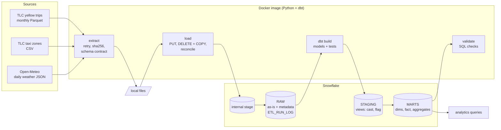

# NYC Taxi + Weather: batch ELT on Snowflake with dbt

A small, production-style batch pipeline. Python extracts three public datasets and loads them unmodified into a Snowflake `RAW` schema; dbt turns them into a tested dimensional model. Everything runs in one Docker image through `make`.

It is an **ELT** pipeline (often filed under "batch ETL"): Python only extracts and loads, and every transformation happens in the warehouse with dbt. That keeps the raw data replayable, puts business logic in version-controlled SQL with tests, and uses Snowflake's compute rather than a container's memory for 11 million rows.

**Stack:** Docker, Python 3.12, Snowflake, dbt Core 1.12 (dbt-snowflake), GitHub Actions.

## Architecture



`make pipeline` runs extract, load, transform, validate in that order and stops at the first failure with a non-zero exit code.

### Lineage

| Layer | Object | Grain | Built from |
|---|---|---|---|
| RAW | `YELLOW_TRIPS` | one trip | monthly Parquet files |
| RAW | `TAXI_ZONE_LOOKUP` | one zone | zone CSV |
| RAW | `WEATHER_DAILY_JSON` | one API response (a month) | Open-Meteo JSON |
| RAW | `ETL_RUN_LOG` | one file per run | the load step |
| STAGING | `stg_yellow_trips` | one trip | renamed, cast, decoded, flagged |
| STAGING | `stg_taxi_zones` | one zone | `N/A` strings to null |
| STAGING | `stg_weather_daily` | one day | JSON arrays flattened |
| MARTS | `dim_zones`, `dim_date` | zone, day | staging |
| MARTS | `fct_trips` | one trip (incremental) | `stg_yellow_trips` |
| MARTS | `agg_daily_trips_weather` | one day | fact + date dim + weather |
| MARTS | `agg_zone_performance` | pickup zone x month | fact + zone dim |

## Quickstart

Prerequisites: Docker Desktop, GNU Make, `openssl`, and a Snowflake account (a free trial works) where you can use `ACCOUNTADMIN` once.

```bash
# 1. Configuration
cp .env.example .env

# 2. Key pair for the pipeline's service user (stays in ./secrets, which is gitignored)
openssl genrsa 2048 | openssl pkcs8 -topk8 -inform PEM -out secrets/rsa_key.p8 -nocrypt
openssl rsa -in secrets/rsa_key.p8 -pubout -out secrets/rsa_key.pub
```

3. Open `sql/00_snowflake_setup.sql`, replace `<PASTE_PUBLIC_KEY_BODY>` with the contents of `secrets/rsa_key.pub` without the `BEGIN`/`END` lines (joined into one line), and run the whole script in a Snowsight worksheet as `ACCOUNTADMIN`. It creates the database, schemas, an X-Small warehouse, a resource monitor, and a least-privilege role and service user.
4. In `.env`, set `SNOWFLAKE_ACCOUNT` to your account identifier in `orgname-accountname` form (Snowsight: account menu, "View account details"). The other defaults match the setup script.

```bash
# 5. Build, check the connection, run everything
make build
make check-connection
make pipeline
```

Other targets (`make help` lists all):

| Target | What it does |
|---|---|
| `make extract` / `load` / `transform` / `validate` | Run one step |
| `make pipeline START=2025-01 END=2025-01` | Run for a different month range |
| `make load FORCE=1` | Reload files even if an identical copy is already in RAW |
| `make analytics` | Print the answers to the business questions |
| `make docs` / `make docs-serve` | Generate dbt docs / serve them on http://localhost:8080 |
| `make test` | Ruff lint, format check and unit tests |
| `make dbt ARGS="build --full-refresh"` | Any dbt command |

## Data sources

All three were checked against the live source before any code was written; URLs and column names are the verified ones.

| Source | What | Terms | Caveats |
|---|---|---|---|
| [NYC TLC Trip Record Data](https://www.nyc.gov/site/tlc/about/tlc-trip-record-data.page), yellow taxi | Monthly Parquet, about 3.5 to 4.1 million trips each. Field meanings from the [TLC data dictionary](https://www.nyc.gov/assets/tlc/downloads/pdf/data_dictionary_trip_records_yellow.pdf) (2025-03-18). | No licence text is published on the page. TLC states: "The trip data was not created by the TLC, and TLC makes no representations as to the accuracy of these data." | Published about two months in arrears. Vendor-submitted, so it contains meter errors (see "Data quality"). Tips are recorded for card payments only. Timestamps are New York local time with no zone. The schema changes between months. |
| NYC TLC Taxi Zone Lookup | CSV, 265 zones | Same page and disclaimer as above | Uses the literal string `N/A` for missing values. Zones 264 and 265 are placeholders for "Unknown" and "Outside of NYC". |
| [Open-Meteo Historical Weather API](https://open-meteo.com/en/docs/historical-weather-api) | Daily temperature, precipitation, rain, snowfall and wind for 40.7128, -74.0060 | [CC BY 4.0](https://open-meteo.com/en/licence). The free API is for non-commercial use, under 10,000 calls a day; this pipeline makes one call per month loaded. | Reanalysis model output for the nearest grid cell (the API returns 40.738, -74.043), not a weather-station observation. One point stands in for the whole city. |

**Attribution:** [Weather data by Open-Meteo.com](https://open-meteo.com/). Taxi data from the NYC Taxi & Limousine Commission.

## Design decisions and trade-offs

**RAW is loaded as-is, with four metadata columns.** `_SOURCE_FILE`, `_FILE_ROW_NUMBER`, `_BATCH_ID` and `_LOADED_AT` are added to every row; nothing is cleaned or filtered in Python. Trade-off: RAW columns are typed (not a single VARIANT), which is easier to query and cheaper to scan, at the cost of needing an explicit answer to schema drift.

**Idempotent loads: delete by file, then COPY, in one transaction.** For each file the load deletes rows previously loaded from that file, runs `COPY INTO ... FORCE = TRUE`, counts the rows now in RAW for that file, and commits only if the count equals the source file's row count. A mismatch rolls back, so a failed load never replaces a good one. A file whose sha256 matches its last successful load is skipped (logged as `SKIPPED`), which avoids rewriting millions of unchanged rows; `FORCE=1` reloads anyway. Trade-off: `FORCE = TRUE` bypasses Snowflake's own load-history deduplication, so correctness rests on the delete being in the same transaction.

**Schema drift is handled by an explicit contract** in `src/sources.py`, checked against each Parquet file's footer before upload. The TLC files really do drift:

| Observed drift | Example | Handling |
|---|---|---|
| Column added | `cbd_congestion_fee` appears in 2025-01 | Optional column: absent means NULL, noted in the run log |
| Name case changed | `airport_fee` (2023) vs `Airport_fee` (2024+) | Matched case-insensitively to one canonical column |
| Numeric type changed | `passenger_count` DOUBLE (2023) vs INT64 (2025) | RAW stores the widest type; staging casts to the business type |
| Unknown new column | none yet | Preserved in `_EXTRA_COLUMNS` (VARIANT) with a warning, not dropped |
| Required column missing, or number became text | none yet | File is rejected before anything is loaded |

The `COPY` select list is generated from the file's actual column names, so the mapping is explicit. Trade-off: more code than `MATCH_BY_COLUMN_NAME`, in exchange for a failure before load rather than silently NULL columns.

**Surrogate key from file and row number.** TLC publishes no trip identifier and no combination of business columns is guaranteed unique, so `trip_key = hash(source file, row number in file)`. It is unique, deterministic, and stable when a month is reloaded. Trade-off: if TLC republishes a file with rows in a different order, keys change; the fact is replaced per file, so it stays consistent.

**`fct_trips` is incremental by file with `delete+insert`.** A run picks up files loaded since the last build and replaces each wholesale. A merge on `trip_key` would leave stale rows behind if a republished file had fewer rows.

**Invalid records are flagged, not dropped.** `stg_yellow_trips` evaluates each rule into a boolean and summarises them in `is_valid_trip`. The fact keeps every row; the aggregated marts use valid trips only. This keeps data-quality rates measurable and the choice reversible. Thresholds are dbt `vars`.

**Key-pair authentication, least-privilege role.** The brief allowed password auth, but Snowflake service users (`TYPE = SERVICE`) cannot use passwords, so the pipeline uses an RSA key pair. Its role can use one warehouse and create objects in three schemas of one database, nothing else; the CLI refuses to run as an admin role. Admin DDL lives in one script that a human runs once.

**One image, pinned.** Python and dbt share an image running as a non-root user. Top-level versions are pinned in `requirements*.txt` and the full resolved set in `requirements.lock`.

## Data quality

| Where | What | On failure |
|---|---|---|
| Extract | Schema contract per source; weather must cover every day of the month; sha256 and size logged per file | File rejected, run stops |
| Load | Source row count vs RAW row count per file, inside the load transaction | Rollback, `FAILED` in `ETL_RUN_LOG`, run stops |
| dbt, severity `error` | `unique` / `not_null` keys, `relationships` from fact to dimensions, `accepted_values` for payment type and rate code, fact row count equals RAW per file, every date has weather | `dbt build` fails, run stops |
| dbt, severity `warn` | Known dirty data: dropoff before pickup, pickup outside the file's month, negative fares | Reported, run continues |
| dbt source freshness | Nothing loaded into RAW for 45 days | Warning |
| `sql/validation` | Run log reconciles with RAW, no duplicate rows in RAW, aggregates sum to the valid trips in the fact | Non-zero exit |

## Cost controls

- X-Small warehouse, `AUTO_SUSPEND = 60` seconds, `AUTO_RESUME`, created suspended.
- Resource monitor: 5 credits a month, notify at 80%, suspend at 100%.
- 15-minute statement timeout on the warehouse.
- Staging models are views; unchanged files are not reloaded; the fact is incremental.
- A 12-month cap on the month range guards against loading years of data by accident.

## Repository layout

```
src/                 Python package: config, extract, load, transform, validate, CLI
tests/               Unit tests (no network, no Snowflake)
sql/00_snowflake_setup.sql   One-time admin setup, run manually
sql/01_raw_objects.sql       RAW tables, stage, file formats (run by the pipeline)
sql/validation/      Post-run checks        sql/analytics/   Business questions
dbt/                 Models, tests, macros, profiles (env vars only)
docker/Dockerfile    docker-compose.yml    Makefile    .github/workflows/ci.yml
```

## Limitations

- Timestamps are naive New York local time, as published. The hour repeated at the end of daylight saving time cannot be told apart.
- One weather point and daily granularity; it cannot explain within-day or neighbourhood effects.
- Validity thresholds (24 hours, 100 miles, 1,000 USD) are judgment calls, not TLC rules.
- Three months is too short to separate weather effects from seasonality.
- The extract keeps a local copy of each file; there is no archive of what was loaded beyond the run log's checksum.
- A new column added to the contract needs a manual `ALTER TABLE ... ADD COLUMN` on an existing RAW table.

## Future improvements (deliberately out of scope)

Orchestration with Airflow or Dagster; streaming ingestion with Kafka; external stages on cloud object storage; infrastructure as code with Terraform; BI dashboards.
